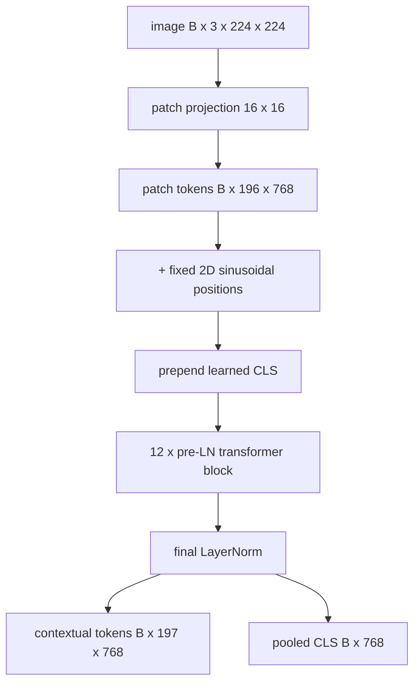

# Vision Transformer Encoder

A from-scratch NumPy implementation of the ViT-Base encoder. The model cuts a
`224 x 224` RGB image into `16 x 16` patches, projects them to 768 dimensions,
prepends a learned CLS token, adds fixed 2D sinusoidal positions, and runs the
sequence through 12 pre-LayerNorm transformer blocks with 12 attention heads.
A final LayerNorm returns the contextual token sequence and the CLS vector that
pools the whole image.

The forward pass and a manual backward pass are implemented directly with
NumPy. There are no pretrained weights, no GPU requirement, and no external
service. Every number in the measured-results section comes from the pinned
local environment and the included fixture.

## Architecture




Each block applies attention to the normalized residual stream and then applies
the feed-forward network to the updated normalized stream:

```text
x1 = x  + attention(norm1(x))
x2 = x1 + feed_forward(norm2(x1))
```

`MultiHeadSelfAttention` uses one fused `qkv` projection of shape
`(2304, 768)`, splits the result into 12 heads of width 64, computes scaled
dot-product attention over all 197 tokens, concatenates the heads, and applies
an output projection. Vision attention is bidirectional, so no causal mask is
used.

| Component | Exact parameters |
|---|---:|
| Patch projection `Conv2d(3, 768, 16, stride=16)` weight + bias | 590,592 |
| Learned CLS token | 768 |
| Per block: qkv projection | 1,771,776 |
| Per block: output projection | 590,592 |
| Per block: FFN `768 -> 3072 -> 768` | 4,722,432 |
| Per block: two LayerNorms (`2 x 1,536`) | 3,072 |
| Per block total | **7,087,872** |
| 12 blocks | 85,054,464 |
| Final LayerNorm | 1,536 |
| **Total** | **85,647,360** |

The per-block count is `12 * hidden^2 + 13 * hidden` at `hidden = 768`; the
linear biases are included. The fixed sinusoidal position table contributes no
parameters. The total rounds to the "about 86M" figure quoted for ViT-Base;
checkpoint counts differ because they may include a classifier head and a
learned position table.

## Design decisions

- **NumPy, not PyTorch.** The lesson is about the encoder mechanism, and one
  pinned dependency keeps verification small. The `Module` surface mirrors the
  callable/parameter shape of `torch.nn.Module`, but no autograd framework is
  involved. The backward pass is written out by hand so the gradient-flow test
  can inspect real gradients.
- **Pre-LN placement.** LayerNorm runs before each sub-layer, inside the
  residual branch. Xiong et al. show that pre-LN keeps gradients well behaved
  at initialization and removes the need for a learning-rate warm-up; this is
  the placement used by modern vision encoders.
- **Twelve heads of width 64.** The 768-dimensional hidden state is split
  evenly across 12 heads, so each head has 64 channels and its own query, key,
  and value slice. The concatenated head outputs are projected back to 768.
- **4x GELU expansion.** The FFN widens to 3072 and contracts back to 768.
  Most of the encoder parameters live in this MLP, matching the ViT recipe.
  GELU uses the tanh approximation, which keeps the derivative dependency-free
  and does not require SciPy.
- **Bidirectional attention.** Every token can attend to every other token.
  The CLS token starts as a learned parameter and accumulates image information
  through all 12 attention layers; the first row of the final token sequence is
  the pooled feature.
- **Fixed 2D sinusoidal positions.** Positions are computed, not learned. The
  row and column sin/cos halves are added after the patch projection, and the
  CLS token is prepended without a spatial position. This mirrors the patch
  front end from lesson 58 while keeping this module standalone.
- **Float32 CPU implementation with a manual backward.** Weights are drawn
  from a seeded local `numpy.random.Generator` at standard deviation `0.02`;
  biases start at zero, LayerNorm scale starts at one, and LayerNorm epsilon is
  `1e-6`. Gradients start at zero, accumulate with `+=`, and are reset by
  `zero_grad()`. Because every module caches the activations from its latest
  forward pass, forward/backward calls must not be interleaved.
- **No training loop.** The demo reports architecture and gradient behavior,
  not accuracy. Random weights are not a trained model.

## Quickstart

Requires Python 3.14 and `uv`. From this module directory:

```bash
cd 59-vit-transformer
./verify.sh
```

`verify.sh` creates an ignored `.venv`, installs the exact pins
(`numpy==2.5.5`, `mypy==2.4.1`), runs the 21 tests, runs mypy, and executes the
full ViT-Base demo. It is safe to run repeatedly.

After the first run, use the venv directly:

```bash
.venv/bin/python -m unittest discover -s code -p 'test_*.py' -v
.venv/bin/python code/main.py
```

Or activate it and use the spec's direct command:

```bash
source .venv/bin/activate
python3 -m unittest code/test_main.py
python3 code/main.py
```

Expected demo shape: the `224 x 224` fixture becomes `14 x 14 = 196` patches,
so the encoded sequence is `(1, 197, 768)` and the pooled CLS is `(1, 768)`.
The default model reports **85,647,360** parameters.

## What runs offline

Everything after the first dependency install runs without a network:

- deterministic fixture synthesis, patch projection, position construction, and
  the full encoder forward pass;
- all 21 unit and gate tests (no network, sleeps, or external fixtures);
- the finite-difference gradient checks and the full demo;
- mypy over `code/`.

Only the `uv pip install` step in `verify.sh` contacts PyPI. The environment is
created in `.venv/`, which is git-ignored. There is no paid API, cloud sandbox,
dataset download, or telemetry.

## Optional real-provider / GPU mode

None is required or simulated. The complete implementation is the NumPy CPU
path above; there is no hidden adapter or service boundary. A pretrained-checkpoint
path would replace the NumPy operations with PyTorch and load a checkpoint such
as `google/vit-base-patch16-224` through `transformers`, but that is
intentionally not wired in: it would add a large dependency and external
weights without changing the mechanism this lesson demonstrates. The block
shapes, pre-LN placement, GELU expansion, CLS pooling, and parameter counts
would remain the same.

## Measured results

Measured locally on CPU with the pinned environment. Forward latency is
machine- and BLAS-dependent and is not a benchmark claim.

- `./verify.sh`: **21 tests passed** (`Ran 21 tests`, `OK`); mypy reported
  `Success: no issues found in 5 source files`; the demo exited 0.
- Demo input shape: `(1, 3, 224, 224)`
- Demo output shape: `(1, 197, 768)`
- Parameter count: `85,647,360`
- Single forward pass in the pinned venv: `0.476 s` on one run and `0.432 s`
  on the second run. The system NumPy installation used a slower BLAS path
  (about 7.8 s), which is why the pinned wheel is used by `verify.sh`.
- CLS norm after block 1: `12.185803`
- CLS norm after block 3: `21.212032`
- CLS norm after block 5: `27.530554`
- CLS norm after block 7: `32.170605`
- CLS norm after block 9: `35.692509`
- CLS norm after block 11: `40.383263`
- CLS norm after the final LayerNorm: `27.712807`
- Pooled CLS shape: `(1, 768)`

The CLS norm drifts upward as the residual stream composes image information,
then the final LayerNorm resets it to roughly `sqrt(768) = 27.71`. These
numbers are from seeded random weights, not trained weights.

## Limitations

- The model is randomly initialized and is never trained. It does not claim
  ImageNet accuracy or any learned representation quality.
- There is no pretrained checkpoint, classifier head, optimizer, or training
  loop.
- Positions are fixed 2D sinusoids for the requested grid; they are not
  interpolated for new resolutions. Images must be divisible by the patch size,
  and patches are square.
- Dropout, stochastic depth, register tokens, causal masking, profiling, and
  LoRA exercises are not implemented; the scope is the forward encoder, its
  gradient check, and the demo.
- The manual backward caches the latest forward pass, so it is a verification
  utility rather than a reentrant autograd engine or a training framework.
- GELU is the tanh approximation rather than the exact `erf` form.
- Execution is single-process CPU NumPy; the forward pass favors clarity over
  throughput.

## References

Sources read and used for this implementation and documentation:

1. [Vision Transformer Encoder capstone spec](https://aiengineeringfromscratch.com/learn/capstone-projects/vit-transformer) — task framing, 12-layer/12-head ViT-Base recipe, build steps, demo, and test expectations.
2. [An Image is Worth 16x16 Words (ViT)](https://arxiv.org/abs/2010.11929) — patch embedding, CLS token, fixed positions, and the transformer encoder recipe.
3. [Attention Is All You Need](https://arxiv.org/abs/1706.03762) — scaled dot-product multi-head self-attention and the 4x feed-forward sub-layer.
4. [On Layer Normalization in the Transformer Architecture](https://proceedings.mlr.press/v119/xiong20b.html) — pre-LN gradient behavior at initialization and the warm-up rationale.
5. [Hugging Face `ViTConfig` documentation](https://huggingface.co/docs/transformers/v4.39.2/en/model_doc/vit) — exact ViT-Base defaults: `hidden_size=768`, `num_hidden_layers=12`, `num_attention_heads=12`, `intermediate_size=3072`, GELU, `qkv_bias=True`, initializer range `0.02`.

## License

MIT © 2026 Pedro Monteiro. See [LICENSE](LICENSE).
