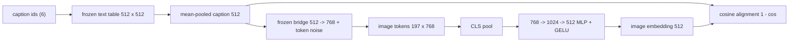

# Projection Layer for Modality Alignment

A from-scratch NumPy implementation of the small bridge that lets a vision
encoder talk to a text model. A frozen mock vision encoder emits `197 x 768`
image tokens; CLS pooling reduces them to one `768`-dimensional vector; a
two-layer linear-GELU-linear MLP projects that vector to `512` dimensions; and
a per-pair cosine alignment loss pulls it toward the mean-pooled embedding of a
paired caption. Only the projector trains.

The module is deliberately self-contained: no pretrained ViT, no tokenizer, no
corpus download, no GPU, and no external service. The fixtures are synthetic
and seeded, so every loss number in this README is reproducible on CPU.

## Architecture



The projector is:

```text
h = x W1^T + b1
a = GELU(h)
y = a W2^T + b2
L = 1 - (y / ||y||) . (t / ||t||)
```

`L` is averaged over a batch. GELU uses the tanh approximation, and the
backward pass is written by hand. The vision encoder and text table expose
`requires_grad=False` parameters and are never handed to the optimizer.

| Component | Shape | Parameters |
|---|---:|---:|
| `fc1` | `(1024, 768)` | 786,432 |
| `fc1` bias | `(1024,)` | 1,024 |
| `fc2` | `(512, 1024)` | 524,288 |
| `fc2` bias | `(512,)` | 512 |
| **Projector total** | | **1,312,256** |
| Frozen text table | `(512, 512)` | 262,144 |
| Frozen vision bridge | `(768, 512)` | 393,216 |

The spec rounds the projector to "about 1.3M"; the exact count is
`1,312,256`.

## Design decisions

- **NumPy with an explicit backward pass.** The track's vision modules are
  NumPy-first, and a projection head is small enough that the gradient path is
  worth seeing directly. `Parameter` carries `data`, `grad`, and
  `requires_grad`; `MLPProjector.backward` accumulates every gradient without
  an autograd framework.
- **Synthetic paired data with a fixed relationship.** `make_pair` samples six
  caption ids without replacement, mean-pools their frozen table rows, pushes
  that caption vector through a fixed random `512 -> 768` bridge, and adds
  small noise. The CLS token carries the bridge output; patch tokens add more
  noise and are discarded by CLS pooling. This gives the projector a real
  learnable target without downloading images or weights.
- **CLS pooling only.** The text side is one vector per caption, so the image
  side must be one vector per image. The first of the 197 tokens is the CLS
  token; `cls_pool` returns exactly that row. Mean pooling over patch tokens is
  a documented exercise, not a second implementation.
- **Two linear layers with one GELU.** A single matrix can rotate and rescale,
  but cannot introduce a non-linear bend. The `768 -> 1024 -> 512` shape keeps
  the canonical LLaVA-style connector proportions and the exact parameter
  budget in the table above.
- **Cosine alignment, not feature equality.** The target direction matters, not
  the target norm. The loss is scale-invariant and bounded in `[0, 2]`, which
  makes the synthetic dynamics easy to inspect. The per-pair form is used here;
  a batch-wise InfoNCE or sigmoid objective is the next step in a larger VLM.
- **Plain SGD, not Adam.** On 32 synthetic pairs, Adam with a typical learning
  rate drives the projector to essentially zero loss by memorization and hides
  the gradual alignment curve. Plain SGD at `lr=0.1`, batch 8, and 200 steps
  shows the bridge learning over time.
- **Frozen means frozen.** Image tokens are materialized once, captions are
  embedded once per evaluation, and the training loop only writes projector
  parameters. The demo snapshots the table, bridge, and tokens and prints
  bit-identical checks after training.

## Quickstart

Requires Python 3.14 and `uv`. From this module directory:

```bash
cd 60-projection-layer-modality-align
./verify.sh
```

`verify.sh` creates an ignored `.venv`, installs the exact pins
(`numpy==2.5.5`, `mypy==2.4.1`), runs the 27 tests, runs mypy, and executes the
full 200-step demo. It is safe to run repeatedly.

After the first run, use the venv directly:

```bash
.venv/bin/python -m unittest code/test_main.py -v
.venv/bin/python code/main.py
```

Or activate it and use the spec's direct commands:

```bash
source .venv/bin/activate
python3 -m unittest code/test_main.py
python3 code/main.py
```

Expected demo behavior: the projector starts around loss `1.00`, prints
full-dataset metrics at steps `0, 25, ..., 200`, and ends with much lower loss
and positive mean cosine. The frozen-unchanged checks print `True`; the
projector-changed check also prints `True`.

## What runs offline

Everything after the first dependency install runs without a network:

- deterministic caption sampling, mock text embeddings, and image-token
  synthesis;
- CLS pooling, projector forward/backward, cosine loss and gradient;
- all 27 unit and gate tests, including finite-difference gradient checks;
- the 200-step training loop and the complete demo;
- mypy over `code/`.

Only the `uv pip install` step in `verify.sh` contacts PyPI. The environment is
created in `.venv/`, which is git-ignored. There is no paid API, dataset
download, model checkpoint, telemetry, or network call in the tests.

## Optional real-provider / GPU mode

None is required or wired. The local core is the complete mechanism; the mock
boundary is explicit:

- Replace `MockVisionEncoder` with a real frozen ViT forward pass that returns
  `(197, 768)` tokens per image, and replace `make_pair` with a real
  image-caption loader.
- Replace `MockTextEmbedding` with a real tokenizer plus embedding table whose
  `caption_embedding(ids)` mean-pools token rows to `(512,)`.
- Keep `MLPProjector`, `cosine_alignment_loss_and_grad`, `train`, and the
  optimizer unchanged. `train` only needs a sequence of
  `(image_tokens, caption_ids)` pairs and a table exposing
  `caption_embedding`.

That adapter would add a large framework and pretrained weights, so it is not
shipped here: this module is intentionally a CPU, deterministic reproduction of
the alignment mechanism. No provider adapter, API key, or GPU path is
pretended to exist.

## Measured results

Measured locally on CPU with the pinned environment. These are single-run
numbers reported as observed, not a benchmark claim; reruns may differ
slightly.

- `./verify.sh`: **27 tests passed** (`Ran 27 tests`, `OK`); mypy reported
  `Success: no issues found in 5 source files`; the demo exited 0.
- Test-suite wall time in the pinned venv: **0.357 s** on the first run and
  **0.471 s** on an immediate second run.
- Full `./verify.sh` wall time: **4.32 s** on the first run and **8.42 s** on
  the second; timing varies between runs, and neither number is a benchmark.
- Demo input: 32 synthetic pairs, each `(197, 768)` image tokens and 6 caption
  ids; projection `768 -> 1024 -> 512`.
- Trainable projector parameters: **1,312,256**.
- Frozen text-table parameters: **262,144**.
- Frozen vision-bridge parameters: **393,216**.
- Initial full-dataset loss: **0.9964**; final loss after 200 steps:
  **0.3565**.
- Initial mean cosine: **+0.0036**; final mean cosine: **+0.6435**.
- Final per-pair cosine range: **+0.44 to +0.80**.
- The demo reported frozen table, frozen bridge, and frozen image tokens
  unchanged (`True`), and projector parameters changed (`True`).

The spec's illustrative trajectory is roughly `1.07 -> 0.80`; the measured
run here goes further. Exact trajectories depend on fixture and optimizer
settings, so this README reports the observed numbers rather than asserting
the spec's illustrative values. The qualitative claim is the same: the frozen
modules stay fixed and only the projection moves.

## Limitations

- The image and text relationship is synthetic and linear. The projector can
  fit 32 pairs easily; this is not evidence of semantic alignment on natural
  images or real language.
- The mock vision encoder is a `768 x 512` random bridge, not an 86M-parameter
  ViT. It preserves the token shapes and the frozen-module contract, not the
  representational quality of a pretrained encoder.
- There is no tokenizer, vocabulary semantics, corpus, or caption language
  model. Caption ids are random integers mapped through the table.
- CLS pooling is the only pooling implementation. Mean pooling, temperature
  scaling, a single-linear comparison, an L2 penalty, and save/reload are
  exercises listed by the spec and are not wired here.
- Training uses plain SGD and a fixed 200-step schedule; there is no
  learning-rate search, early stopping, or validation split.
- The objective is per-pair cosine alignment, not InfoNCE or SigLIP-style
  batch contrastive loss. Every image is aligned only to its own caption; no
  in-batch negative is used.
- Execution is single-process CPU NumPy. The demo is intentionally small and
  the reported wall time is not a GPU or throughput benchmark.

## References

Sources read and used for the implementation and this README:

1. [Projection Layer for Modality Alignment capstone spec](https://aiengineeringfromscratch.com/learn/capstone-projects/projection-layer-modality-align) — build steps, `768 -> 1024 -> 512` shape, 197-token/CLS contract, cosine objective, and test expectations.
2. [Improved Baselines with Visual Instruction Tuning (LLaVA-1.5)](https://arxiv.org/abs/2310.03744) — the two-layer MLP vision-language connector, frozen vision encoder during alignment pretraining, and the comparison to a single linear projection.
3. [BLIP-2: Bootstrapping Language-Image Pre-training with Frozen Image Encoders and Large Language Models](https://arxiv.org/abs/2301.12597) — the lightweight Q-Former bridge between a frozen image encoder and a frozen language model.
4. [Qwen-VL: A Versatile Vision-Language Model for Understanding, Localization, Text Reading, and Beyond](https://arxiv.org/abs/2308.12966) — the position-aware cross-attention adapter that compresses visual tokens before the language model.
5. [Sigmoid Loss for Language Image Pre-Training (SigLIP)](https://arxiv.org/abs/2303.15343) — the pairwise sigmoid alternative to batch-normalized contrastive loss, cited as the batch-wise generalization this per-pair lesson does not implement.

## License

MIT © 2026 Pedro Monteiro. See [LICENSE](LICENSE).
