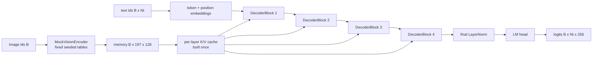

# Cross-Attention Fusion

A from-scratch NumPy vision-language decoder that keeps text and image streams
separate and bridges them with multi-head cross-attention. Text tokens are the
queries; a fixed pool of 197 image memory tokens supplies the keys and values.
Every one of the four pre-LN decoder blocks runs causal text self-attention,
then cross-attention into the image memory, then a GELU feed-forward network.

The module is deliberately local and deterministic: a small learned text
embedding table, a synthetic vision-encoder fixture, and seeded initialization.
No pretrained ViT, tokenizer, corpus, GPU, or paid API is required. The point is
the mechanism and its two asymmetries: causal masking only on the text stream,
and image K/V tensors that are projected once and reused for every decode step.

## Where this shape appears

**Flamingo and IDEFICS.** Late fusion inserts cross-attention blocks between a
frozen language model's blocks; the text stream asks questions of visual memory.
Flamingo gates each new residual with a learnable `tanh(alpha)` initialized to
zero, which lets the original language model behavior survive initialization.
This baseline follows the lesson and omits the gate; the ungated block has the
same query/key/value routing.

**BLIP-2.** The Q-Former is cross-attention with a learned query pool: 32 query
vectors attend to frozen image features, and the resulting 32 x 768 queries are
projected into the language model. The text-query/vision-memory shape here is
the same building block with text queries instead of learned queries.

## Architecture



Each block is pre-LN with three residual sub-layers:

```text
x = x + CausalSelfAttention(LN1(x), causal_mask)
x = x + CrossAttention(LN2(x), memory K/V)
x = x + FeedForward(LN3(x))
```

The cross-attention layer has separate query and key/value projections:

```text
Q = LN2(x) Wq^T + bq                 # text queries
K, V = LN2(x) Wkv^T + bkv           # from image memory
scores = Q K^T / sqrt(head_dim)      # no key mask
weights = softmax(scores, axis=-1)
out = weights V
```

`CausalSelfAttention` uses one fused QKV projection; `CrossAttention` keeps
`q_proj` and `kv_proj` separate because the two streams have different roles.
The feed-forward width is `4 * hidden`.

### Shapes

| Tensor | Shape | Notes |
|---|---|---|
| text ids | `(B, Nt)` | demo `B=2`, `Nt=10` |
| image memory | `(B, Nv, hidden)` | demo `Nv=197`, `hidden=128` |
| text queries | `(B, heads, Nt, head_dim)` | `heads=4`, `head_dim=32` |
| image keys/values | `(B, heads, Nv, head_dim)` | cached per layer |
| causal mask | `(Nt, Nt)` | lower-triangular boolean |
| cross mask | `(Nt, Nv)` | none in the baseline |
| logits | `(B, Nt, vocab_size)` | demo `(2, 10, 256)` |

Attention uses `scores = Q K^T / sqrt(head_dim)` followed by a numerically
stable softmax. The mask convention is **True = visible, False = masked out**.
Masked scores are set to `-inf` before softmax.

### Mask discipline

| Attention | Query length | Key length | Mask | Why |
|---|---:|---:|---|---|
| Self-attention | `Nt` | `Nt` | causal `(Nt, Nt)` | text tokens may not see the future |
| Cross-attention | `Nt` | `Nv` | none | the whole image is observed before decoding |

`validate_attention_masks` is the single shape gate. It rejects:

- a text mask that is not exactly `(Nt, Nt)`;
- a cross mask that is not exactly `(Nt, Nv)`;
- non-boolean masks;
- upper-triangular text masks (a swapped cross mask is the common mistake here);
- any mask row with no visible key.

Cross-attention accepts an optional contextual mask for callers that need it,
but the demo and tests pass `None`: every text position sees every image patch.

### Key/value caching

`CrossAttention.build_cache(memory)` projects memory to K and V once, splits
the heads, copies the arrays, and marks them read-only. `VisionLanguageDecoder`
builds one cache per layer with `encode_image` and returns a `DecoderCache`.
Cached decoding reuses that object for every step; the text side is recomputed
from the growing prefix, while the image projections are not.

The uncached path internally calls `build_cache` and then runs the same cached
attention code, so the two paths are mathematically identical. The demo and
tests compare their logits directly. Only image K/V are cached; this lesson
does not implement a text self-attention KV cache.

### Mock vision encoder

`MockVisionEncoder` is an explicit synthetic fixture, not a ViT. Image ids
index fixed seeded tables and produce

```text
memory = tanh((image_embedding[id] + position_embedding) @ mix)
```

with shape `(B, 197, 128)`. Distinct image ids produce distinct memory. The
text table, position table, and LM head are also randomly initialized and are
not trained. This gives the attention and cache code realistic shapes and
deterministic behavior without pretending to be a pretrained model.

## Design decisions

- **NumPy, forward-only.** The lesson is about forward routing, masks, and
  caching, not training. There is no autograd engine, optimizer, or checkpoint.
  Keeping the implementation forward-only keeps the attention path readable.
- **Pre-LN blocks.** Layer normalization sits inside each residual branch. The
  pre-LN placement has well-behaved initialization gradients compared with
  post-LN, and it is the standard decoder shape used by Flamingo-style models.
- **Fused self-attention QKV, separate cross-attention Q/KV.** Self-attention
  has one source stream, so one projection is enough. Cross-attention has two
  streams, so `q_proj` and `kv_proj` are separate by construction.
- **No gate, no dropout.** These are the canonical baseline; Flamingo's
  `tanh(alpha)` gate and query-side dropout are listed as exercises in the
  source lesson and are not wired here.
- **Learned text positions.** The spec names a small text embedding table. A
  position table is added so the decoder has a token-order signal; without it,
  attention would be permutation-sensitive only through the causal mask.
- **Read-only cache arrays.** The image K/V cache is long-lived and shared
  across decode steps. Making the arrays read-only turns accidental in-place
  mutation into an immediate error instead of a silent cache-corruption bug.
- **Shape-first validation.** The 2-D mask split is the easiest part of this
  architecture to get subtly wrong. Explicit shape and row checks make the
  failure a `ValueError` at the boundary rather than a bad loss curve later.
- **Deterministic fixtures over downloads.** The local demo is fast, network
  free after install, and reproducible. The real-model boundary is documented
  rather than half-implemented.

## Quickstart

Requires Python 3.14 and `uv`. From this module directory:

```bash
cd 61-cross-attention-fusion
./verify.sh
```

`verify.sh` creates an ignored local `.venv`, installs the exact pins
(`numpy==2.5.5`, `mypy==2.4.1`), runs the 53 tests, runs mypy, and executes the
demo. It is safe to run repeatedly.

After the first run, use the venv directly:

```bash
source .venv/bin/activate
python3 -m unittest code/test_main.py -v
python3 code/main.py
```

The demo prints the required shapes and the cache check:

```text
dimensions: hidden=128, heads=4, layers=4, vocab=256
text: 2 sequences x 10 tokens; image memory: 2 x 197 tokens
decoder parameters: 1,132,544
logits shape: (2, 10, 256)
self-attention mask shape: (10, 10)
causal mask is lower-triangular: True
KV-cache max |logit delta|: 0.000e+00
cached logits match uncached: True
```

It also prints the cross-attention output norm for each position of the first
sample and runs three greedy cached decode steps from a five-token prefix.

## What runs offline

After the first `./verify.sh` provisions Python and the pinned packages, the
following run without network access:

- all 53 unit and contract tests, including the manual per-head cross-attention
  reference and the cache-vs-uncached logit comparison;
- mypy over the implementation and test files;
- the full deterministic demo, including cached incremental decoding;
- every fixture and assertion; tests make no network calls.

Only `.venv/` is created for dependencies. It and the mypy cache are
git-ignored. There is no corpus download, checkpoint, telemetry, or provider
call.

## Optional real-provider / GPU mode

None is required or shipped. The local core is the complete mechanism; only
the image and text fixtures are synthetic. The adapter boundary is:

- **Vision:** replace `MockVisionEncoder.encode` with a real frozen ViT forward
  pass producing `(B, Nv, D)` patch tokens. If `D != hidden`, add a
  `Linear(D, hidden)` projection (or construct the decoder with `hidden=D`) and
  pass the projected tokens to `encode_image` or `forward(image_tokens=...)`.
- **Text:** replace the seeded token and position tables with a real tokenizer
  and pretrained embedding table aligned to `vocab_size`; `embed` still returns
  `(B, Nt, hidden)`.
- **Compute:** the attention and cache API are framework-independent. A GPU
  implementation can replace the NumPy matmuls while preserving the same
  `CrossAttentionCache` / `DecoderCache` contract. No GPU path is included here.

That adapter would add a large framework, pretrained weights, and a real
image-text loader. This module intentionally does not pretend those exist.

## Measured results

Measured locally with the pinned environment. These are single-run observations,
not benchmark claims; wall times vary between runs.

- `./verify.sh` exited 0 twice.
- Test suite: **53 tests**, `OK`, **0.212 s** on the first run and **0.160 s**
  on the immediate second run.
- Full `./verify.sh` wall time: **1.508 s** on the first run (creating `.venv`
  and installing seven packages) and **0.807 s** on the second.
- mypy: `Success: no issues found in 5 source files`.
- Demo input: 2 text sequences of length 10, image memory `2 x 197 x 128`.
- Logits shape: **`(2, 10, 256)`**; causal mask shape: **`(10, 10)`** and
  lower-triangular.
- Decoder parameters: **1,132,544** (four blocks: 1,058,304; embeddings, final
  norm, and LM head: 74,240).
- Mock vision encoder parameters: **42,624** fixed fixture values.
- Cache size for the demo batch: **100,864 floats / 403,456 bytes per layer**;
  **403,456 floats / 1,613,824 bytes** across four layers.
- `KV-cache max |logit delta|`: **0.000e+00**; cached and uncached full-sequence
  logits match exactly.
- Cached greedy decoding from a 5-token prompt produced 8 tokens; cached and
  uncached logits on that prefix matched with maximum delta **0.000e+00**.
- First-layer cross-attention output norms for sample 1 ranged from
  **0.7141521** to **0.7141659** (range `1.38e-05`). The norms are nearly flat
  because the random, untrained output projection's bias dominates the
  query-dependent component; this is a shape and routing check, not evidence of
  learned grounding.
- Per-layer mean cross-attention output norms were approximately
  `0.7270`, `0.6628`, `0.6618`, and `0.6107` for layers 1-4.

## Limitations

- The model is randomly initialized and forward-only. It has no language
  quality, caption accuracy, or grounding claim; the demo checks shapes,
  causality, and cache equivalence.
- Image inputs are synthetic image ids indexing fixed tables. The mock encoder
  preserves the token shape and frozen-stream boundary, not ViT semantics.
- Text ids are arbitrary integers; there is no tokenizer, vocabulary semantics,
  or corpus. The text embedding table is not pretrained.
- The Flamingo `tanh` gate, query-side dropout, multi-image interleaving (and its
  per-sample cross mask), self-attention KV caching, and the Q-Former query-pool
  variant are exercises in the source lesson and are not implemented here.
- The implementation is single-process CPU NumPy. Hidden 128, four heads, four
  layers, and 197 memory tokens keep the demo fast; no throughput, memory, or
  scaling benchmark is claimed.
- No FlashAttention, mixed precision, distributed execution, checkpoint
  loading, or training loop is included.

## References

Sources read and used for the implementation and this README:

1. [Cross-Attention Fusion capstone spec](https://aiengineeringfromscratch.com/learn/capstone-projects/cross-attention-fusion) — build steps, mask shapes, 197-token demo, KV-cache check, and test expectations.
2. [Flamingo: a Visual Language Model for Few-Shot Learning](https://arxiv.org/abs/2204.14198) — late-fusion cross-attention inserted between frozen LM blocks, and the zero-initialized `tanh` gate that this baseline omits.
3. [BLIP-2: Bootstrapping Language-Image Pre-training with Frozen Image Encoders and Large Language Models](https://arxiv.org/abs/2301.12597) — the Q-Former's 32 learned queries cross-attending into image features.
4. [Introducing IDEFICS: An Open Reproduction of State-of-the-Art Visual Language Model](https://huggingface.co/blog/idefics) — open Flamingo-style reproduction built from public frozen models.
5. [On Layer Normalization in the Transformer Architecture](https://arxiv.org/abs/2002.04745) — pre-LN gradients at initialization and the motivation for pre-LN blocks.

## License

MIT © 2026 Pedro Monteiro. See [LICENSE](LICENSE).
