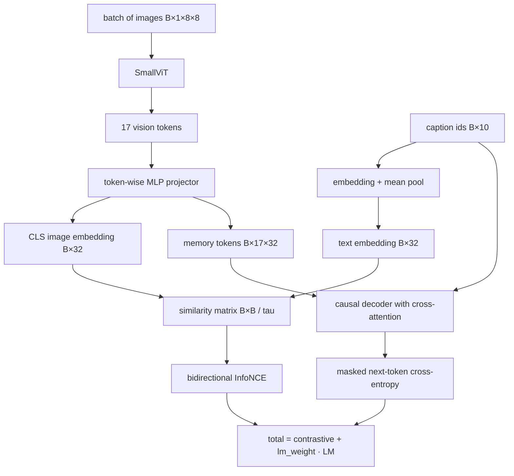

# 62 — Vision-Language Pretraining

Train a small image-text model with **two objectives in one pass**:

- **Bidirectional InfoNCE** ranks images against captions in a shared embedding space.
- **Masked language modeling** makes the decoder write a caption for each image.

The vision encoder and projector receive gradients from both losses; the text tower trains on the contrastive loss and the decoder on the language-modeling loss. Everything is implemented from scratch in NumPy, including the backward passes, the optimizer, the cross-attention decoder, and the synthetic corpus. No PyTorch, no downloads, no API keys.

This is module `62-vision-language-pretraining` of the *Multimodal From Scratch* track and implements the [Vision-Language Pretraining capstone](https://aiengineeringfromscratch.com/learn/capstone-projects/vision-language-pretraining) end to end.

## What is measured

Running the 50-step demo (`./verify.sh` or `.venv/bin/python code/main.py`) on CPU, seed 62:

| Step | Contrastive | LM | Total | Temperature |
| ---: | ---: | ---: | ---: | ---: |
| 1 | 3.5117 | 6.6953 | 10.2070 | 0.0702 |
| 5 | 2.6597 | 4.7116 | 7.3712 | 0.0708 |
| 10 | 3.5934 | 3.5976 | 7.1909 | 0.0705 |
| 25 | 1.5805 | 2.5948 | 4.1753 | 0.0708 |
| 50 | 0.4424 | 2.3459 | 2.7883 | 0.0684 |

Full-corpus evaluation, including 200-way retrieval:

| Metric | Before | After |
| --- | ---: | ---: |
| Contrastive | 4.6847 | 1.1990 |
| LM | 6.7004 | 2.3572 |
| Total | 11.3851 | 3.5562 |
| Image → text top-1 | 0.0050 | 0.3550 |
| Text → image top-1 | 0.0100 | 0.4200 |

Both objectives decrease and retrieval rises above the 0.5% / 1.0% random baselines. The contrastive value at step 10 is above step 5 because each step draws a different random batch; the final full-corpus numbers are the stable comparison.

### Objective ablation

The spec's exercise 5 asks whether adding the LM loss regresses contrastive ranking. Measured locally over three seeds (50 steps, batch 16, otherwise identical settings; no hyperparameter search):

| `lm_weight` | Contrastive | LM | Image → text | Text → image |
| ---: | ---: | ---: | ---: | ---: |
| 0.0 | 1.2424 | 6.6106 | 0.338 | 0.377 |
| 1.0 | 1.1898 | 2.3148 | 0.362 | 0.425 |

These are means over seeds 62–64. Per-seed results vary enough that this is **not** evidence that the LM objective helps ranking in general: seed 62 alone preferred `lm_weight=0` on retrieval. It does show that the two losses can be optimized together without NaN/divergence in this setup. Reproduce with:

```python
from code.main import build_default_model, make_mock_corpus, train

for lm_weight in (0.0, 1.0):
    corpus = make_mock_corpus(seed=62, n_pairs=200)
    model = build_default_model(seed=62)
    report = train(
        model, corpus, steps=50, batch_size=16,
        lm_weight=lm_weight, seed=62, print_fn=lambda _: None,
    )
    print(lm_weight, report.final)
```

## Architecture



Default sizes:

| Piece | Configuration |
| --- | --- |
| Image | 8×8 grayscale, 2×2 patches |
| ViT | 2 layers, hidden 32, 2 heads, 17 tokens (CLS + 16 patches) |
| Projector | 32 → 64 → 32, GELU |
| Text tower | 512-token embedding, hidden 32, masked mean pool, linear to 32 |
| Decoder | 2 cross-attention layers, hidden 64, 4 heads, causal self-attention |
| Vocabulary | 512 ids: pad 0, bos 1, eos 2, content 3–18 |
| Parameters | 208,929 |
| Optimizer | Adam, lr 3e-3, global gradient-norm clip 1.0 |

### Losses

Let image and text embeddings be $\hat I \in \mathbb{R}^{B \times D}$ and $\hat T \in \mathbb{R}^{B \times D}$ after row-wise L2 normalization, and let $S = \hat I \hat T^\top / \tau$. InfoNCE is the average of two cross-entropies:

$$
\mathcal{L}_{\text{InfoNCE}} =
-\frac{1}{2}\left(
\frac{1}{B}\sum_i \log \frac{e^{S_{ii}}}{\sum_j e^{S_{ij}}}
+
\frac{1}{B}\sum_j \log \frac{e^{S_{jj}}}{\sum_i e^{S_{ij}}}
\right)
$$

The language-model loss uses the decoder logits $z_{b,t}$ and target ids $y_{b,t}$, excluding padding positions:

$$
\mathcal{L}_{\text{LM}} =
-\frac{1}{\sum_{b,t} m_{b,t}}
\sum_{b,t:\,m_{b,t}=1} \log p_\theta(y_{b,t}\mid y_{b,<t}, I_b)
$$

Total loss:

$$
\mathcal{L} = \mathcal{L}_{\text{InfoNCE}} + w_{\text{lm}}\,\mathcal{L}_{\text{LM}},
\qquad w_{\text{lm}} = 1.0.
$$

### Learned temperature

`log_temperature` is a scalar parameter initialized to $\tau = 0.07$, matching the CLIP recipe [1]. The forward pass computes $\tau = e^{\log \tau}$ and clamps it to $[0.01, 1.0]$. The lower bound caps the logit scale at 100, matching CLIP's stability clip; the upper bound keeps the similarity matrix from collapsing to a uniform softmax. The analytic gradient with respect to $\log \tau$ is checked against central differences.

### Gradient routing

| Parameter group | InfoNCE | LM | Receives gradient |
| --- | :---: | :---: | --- |
| ViT + projector | yes | yes (via memory tokens) | both |
| Text tower | yes | no | contrastive only |
| Decoder | no | yes | LM only |
| Log-temperature | yes | no | contrastive only |

The CLS token of the projected sequence is the contrastive image embedding; all 17 projected tokens are the decoder memory. That is the deliberate difference from a two-tower CLIP model: the same trunk must serve retrieval and generation.

## Quickstart

Requires Python 3.14 and [uv](https://docs.astral.sh/uv/). CPU only.

```bash
cd multimodal-from-scratch/62-vision-language-pretraining
./verify.sh
```

`verify.sh` is idempotent: it creates `.venv/`, installs the pinned requirements into it, runs unittest discovery, runs mypy, and executes the demo. The demo exits non-zero if either loss fails to decrease.

Manual commands:

```bash
.venv/bin/python code/main.py
.venv/bin/python -m unittest discover -s code -p 'test_*.py' -v
.venv/bin/python -m mypy code
```

The demo takes about 2–3 seconds on a modern x86-64 CPU. Python 3.14.10, NumPy 2.5.5, and mypy 2.4.1 were used for the measurements above.

## What runs offline

Everything after dependency installation:

- synthetic images and captions are generated from seed 62;
- model weights are initialized from explicit seeds;
- the training batches are sampled from a seeded NumPy generator;
- tests use no network, no token-shaped secrets, and no external fixtures;
- no dataset download, no pretrained checkpoint, no paid provider.

The only networked step is the first `uv pip install` of the two pinned packages. Set `UV_OFFLINE=1` after the environment exists if you want to verify that reruns make no network calls.

## The synthetic corpus

`make_mock_corpus(seed, n_pairs=200)` returns:

- `images`: `(200, 1, 8, 8)` float32 arrays;
- `captions`: `(200, 10)` int64 arrays with `BOS, 6 content ids, EOS, PAD, PAD`.

Each caption is six distinct content ids drawn from 16 possibilities. For every content id, a deterministic 2×2 visual code derived from `cos`/`sin` is painted into its own patch of the image, then low-amplitude Gaussian noise is added. The image therefore *contains* the information needed to predict the caption, while remaining a tiny fixture with no natural-image semantics.

This is a deliberate improvement over literally random images with random caption ids: pure noise has no learnable relationship, so a loss on it can only fluctuate, not demonstrate that gradients are wired correctly. The spec's illustrative numbers (contrastive near $\ln 16$, LM near $4.7$) assume the easier demonstration regime; the absolute values here differ because the corpus is learnable and the initial temperature is small. The required qualitative check is the same: both losses fall.

## Tests

38 tests total:

- `code/test_main.py` — 23 detailed tests: InfoNCE symmetry, perfect-diagonal zero loss, uniform-baseline $\ln B$, single-pair zero, finite-difference gradients for both losses and the temperature, padding masks, LayerNorm/attention gradients, causal leakage, patch round-trip, corpus construction, retrieval metric, optimizer temperature range, and a 5-step `train()` integration check.
- `code/tests/test_gate.py` — 15 top-level contract tests that assert the same core behaviors through a second import path, plus that every parameter receives a finite gradient and that `lm_weight=0` leaves the decoder untouched.

The finite-difference checks are the important ones: the hand-written backward pass is verified numerically, not by shape assertions alone.

## Design decisions

1. **NumPy with explicit backward passes.** The point of the module is to show the gradient plumbing, so autograd is not used. Parameter storage is float32; softmax, loss accumulation, and normalization use float64 for stability. Analytic gradients are validated with central differences.
2. **One shared vision trunk.** The projector output feeds both the contrastive CLS embedding and the decoder's cross-attention memory. This reproduces the multi-task gradient path of CoCa [2] at toy scale.
3. **Learned log-temperature with a hard range.** A raw temperature can cross zero or explode; optimizing $\log \tau$ and clamping keeps the softmax well-conditioned [1].
4. **Padding is masked in both directions.** PAD ids are excluded from the text mean pool and from the LM cross-entropy, so the two padded positions contribute neither loss nor gradient.
5. **Causal decoder, verified.** Changing the final caption token cannot change earlier logits. The decoder uses pre-LN blocks, learned positions, and cross-attention to the projected memory.
6. **Determinism over realism.** Fixed seeds, a small model, and 50 steps make the demo reproducible in seconds. That is the right trade-off for a gradient-plumbing demonstration; it is not a benchmark.
7. **No checkpoint files.** The model is rebuilt from seeds on every run. There is no sparse binary artifact to keep in git.

## Real-data / GPU boundary

Nothing in this module calls a real provider, downloads a dataset, or uses a GPU. The simulated pieces are explicit:

- **images**: synthetic 8×8 visual codes, not photographs;
- **captions**: generated id sequences, not tokenized natural language;
- **weights**: random initialization, not a pretrained backbone;
- **compute**: single-process CPU NumPy.

To plug in real data, keep the contracts rather than the fixture:

1. Produce float32 images shaped `(N, C, 8, 8)` and int64 captions of length 10, or change `IMAGE_SIZE`, `PATCH_SIZE`, `CAPTION_LEN`, and `VOCAB_SIZE` together.
2. Replace `make_mock_corpus` with a loader returning the same `MockCorpus` fields. For natural images at a realistic resolution, enlarge `SmallViT` and the decoder; the contrastive and LM losses do not depend on those sizes.
3. For a real tokenizer, map text to ids in `[0, VOCAB_SIZE)` and keep PAD/BOS/EOS distinct.
4. For GPU training, port the layers to PyTorch (or JAX) and reuse the loss definitions in `code/main.py` as the reference. A GPU adapter is **not shipped**: the NumPy implementation is the deliverable, and an incomplete adapter would misrepresent the boundary.

The same applies to a pretrained CLIP or CoCa-style model: this repository demonstrates the objective and the gradient routing, not the scale at which those objectives become competitive.

## Limitations

- Synthetic 8×8 images; no natural-image semantics, no zero-shot transfer claims.
- The text tower is a mean-pooled embedding, not a transformer; it is sufficient for the contrastive path here but far below real text encoders.
- 50 steps on 200 pairs, evaluated on the same pairs. Reported retrieval is in-corpus and optimistic; there is no held-out split.
- Batch-dependent contrastive loss means the training-batch value (batch 16) and the full-corpus value (batch 64) are not directly comparable.
- One seed for the demo; the ablation averages three seeds but remains a small-sample observation.
- No SigLIP sigmoid loss, hard-negative mining, image-text-matching head, or Markov-chain corpus. Those are exercises 1–4 in the spec and are intentionally out of scope.
- No checkpointing, mixed precision, distributed training, or GPU path.

## Project layout

```text
62-vision-language-pretraining/
├── code/
│   ├── main.py            # model, losses, corpus, optimizer, training, demo
│   ├── test_main.py       # detailed unit and gradient tests
│   └── tests/
│       ├── __init__.py
│       └── test_gate.py   # top-level contract tests
├── .gitignore
├── .python-version
├── LICENSE
├── README.md
├── mypy.ini
├── requirements.txt
└── verify.sh
```

## References

1. Radford, A., Kim, J. W., Hallacy, C., et al. (2021). *Learning Transferable Visual Models From Natural Language Supervision.* arXiv:2103.00020. <https://arxiv.org/abs/2103.00020> — the symmetric InfoNCE recipe, the learned temperature initialized at 0.07, and the logit-scale clip.
2. Yu, J., Wang, Z., Vasudevan, V., et al. (2022). *CoCa: Contrastive Captioners are Image-Text Foundation Models.* arXiv:2205.01917. <https://arxiv.org/abs/2205.01917> — combining a contrastive loss with an autoregressive captioning loss over a shared image encoder.
3. Li, J., Li, D., Xiong, C., Hoi, S. (2022). *BLIP: Bootstrapping Language-Image Pre-training for Unified Vision-Language Understanding and Generation.* arXiv:2201.12086. <https://arxiv.org/abs/2201.12086> — the understanding/generation split that motivates keeping a retrieval head and a caption decoder in one stack.
4. Zhai, X., Mustafa, B., Kolesnikov, A., Beyer, L. (2023). *Sigmoid Loss for Language Image Pre-Training.* arXiv:2303.15343. <https://arxiv.org/abs/2303.15343> — the SigLIP alternative to softmax InfoNCE and its batch-size trade-offs, referenced when scoping exercises.
5. AI Engineering from Scratch. *Vision-Language Pretraining* capstone specification. <https://aiengineeringfromscratch.com/learn/capstone-projects/vision-language-pretraining> — the build steps, required tests, and expected demo behavior.

## License

MIT — see [LICENSE](LICENSE). Copyright (c) 2026 Pedro Monteiro.
